

&nbsp;&nbsp;&nbsp;&nbsp;

 

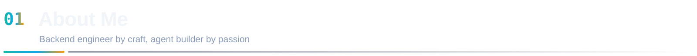

  

  

 

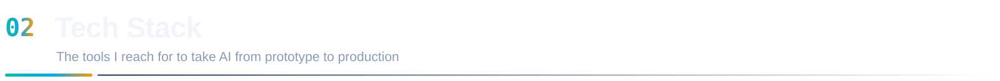

  

 

  

  

<table>
<tr>
<td width="50%" align="center" valign="top">

 
&nbsp;
</td>
<td width="50%" align="center" valign="top">

 
&nbsp;
</td>
</tr>
<tr>
<td width="50%" align="center" valign="top">

 

</td>
<td width="50%" align="center" valign="top">

 
&nbsp;
</td>
</tr>
</table>

 

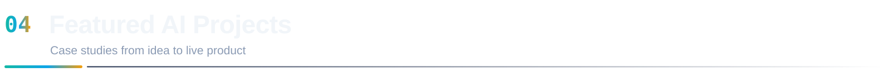

<table>
<tr>
<td width="50%" align="center" valign="top">

 

</td>
<td width="50%" align="center" valign="top">

 

</td>
</tr>
<tr>
<td width="50%" align="center" valign="top">

 
&nbsp;
</td>
<td width="50%" align="center" valign="top">

 

</td>
</tr>
</table>

 

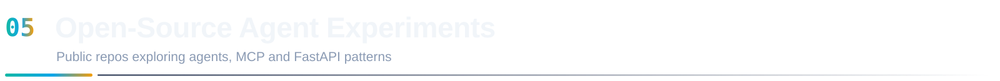

<table>
<tr>
<td width="50%"><a href="https://github.com/Alisha-kayani/sky_cast_agent"></a></td>
<td width="50%"><a href="https://github.com/Alisha-kayani/shopping_crew"></a></td>
</tr>
<tr>
<td width="50%"><a href="https://github.com/Alisha-kayani/mcp_openai_agents_sdk"></a></td>
<td width="50%"><a href="https://github.com/Alisha-kayani/openai-agents-sdk"></a></td>
</tr>
<tr>
<td width="50%"><a href="https://github.com/Alisha-kayani/fastapi-ratelimiting"></a></td>
<td width="50%"><a href="https://github.com/Alisha-kayani/fastpi-caching-redis"></a></td>
</tr>
</table>

 

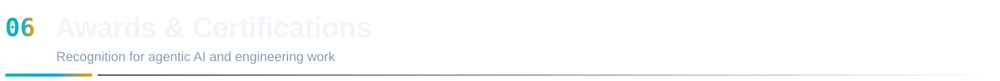

<table>
<tr>
<td width="50%"><a href="https://alisha-kayaniai.vercel.app/images/ai-seekho-2026-certificate.png"></a></td>
<td width="50%"><a href="https://alisha-kayaniai.vercel.app/images/piaic-agentic-ai-level1-certificate.png"></a></td>
</tr>
<tr>
<td width="50%"></td>
<td width="50%"><a href="https://panaversity.org/p/mem29423-eiy4"></a></td>
</tr>
<tr>
<td width="50%"><a href="https://codeinplace.stanford.edu/cip5/certificate/4v8xfd"></a></td>
<td width="50%"><a href="https://cdn.unstop.com/uploads/user-project-files/67d7b03cad4fd_uc_37167ae2_6702_47a9_bcd8_ffcf85e29054_jpg_other.jpg"></a></td>
</tr>
</table>

 

  

  <picture>
    <source media="(prefers-color-scheme: dark)" srcset="https://raw.githubusercontent.com/Alisha-kayani/Alisha-kayani/output/github-snake-dark.svg"/>
    
  </picture>

 

  

