

  &nbsp;
  &nbsp;
  

📍 <b>Islamabad, Pakistan</b> &nbsp;|&nbsp; 🌍 <b>Open to Remote Opportunities</b>

  &nbsp;
  &nbsp;
  &nbsp;
  &nbsp;
  

---

## 👩‍💻 About Me

I'm a **Backend Software Engineer and Agentic AI Developer** specialising in **Python, FastAPI and autonomous AI agents**. At **Postsiva** I build the FastAPI core behind a unified social media OS (automation, scheduling, AI workflows and analytics) and lead social growth. I also teach Computer Science part-time at CISD, Islamabad.

- 🎓 **Software Engineering**, Virtual University (2020 – 2024)
- 🤖 **PIAIC Agentic AI Professional Developer, Levels 1 & 2** (Cloud Native Applied Generative AI)
- 🛠️ I build **agents that reason, plan and execute**: WhatsApp ordering bots, RAG exam generators and social automation. These are working products, not demos.

  

---

## 🧰 Tech Stack

   
  

  
  
  
  
  
  
  
  

---

# 💼 Experience

  

## 🚀 Postsiva

  <a href="https://postsiva.com/"></a>

<table>
<tr>
<td width="50%" align="center" valign="top">
<a href="https://alisha-kayaniai.vercel.app/projects/postsiva"></a>
 
&nbsp;
</td>
<td width="50%" align="center" valign="top">
<a href="https://alisha-kayaniai.vercel.app/projects/postsiva-youtube"></a>
 
&nbsp;
</td>
</tr>
<tr>
<td width="50%" align="center" valign="top">
<a href="https://alisha-kayaniai.vercel.app/projects/postsiva-facebook"></a>
 

</td>
<td width="50%" align="center" valign="top">
<a href="https://alisha-kayaniai.vercel.app/projects/automatev"></a>
 
&nbsp;
</td>
</tr>
</table>

---

# 🤖 Featured AI Projects

<table>
<tr>
<td width="50%" align="center" valign="top">
<a href="https://alisha-kayaniai.vercel.app/projects/alisha-kitchen-whatsapp-agent"></a>
 

</td>
<td width="50%" align="center" valign="top">
<a href="https://alisha-kayaniai.vercel.app/projects/questify"></a>
 

</td>
</tr>
<tr>
<td width="50%" align="center" valign="top">
<a href="https://alisha-kayaniai.vercel.app/projects/fitlife"></a>
 
&nbsp;
</td>
<td width="50%" align="center" valign="top">
<a href="https://github.com/Alisha-kayani/AI-Image-Generator"></a>
 

</td>
</tr>
</table>

### 🧪 Open-source agent experiments

| Repo | What it shows |
|---|---|
| [sky_cast_agent](https://github.com/Alisha-kayani/sky_cast_agent) | Live-weather chatbot · OpenAI Agents SDK + Chainlit |
| [shopping_crew](https://github.com/Alisha-kayani/shopping_crew) | CrewAI shopping crew with a Chainlit UI |
| [mcp_openai_agents_sdk](https://github.com/Alisha-kayani/mcp_openai_agents_sdk) | Custom MCP server with the OpenAI Agents SDK |
| [openai-agents-sdk](https://github.com/Alisha-kayani/openai-agents-sdk) | OpenAI Agents SDK starter |
| [RAG](https://github.com/Alisha-kayani/RAG) | RAG concepts, notes and walkthroughs |
| [fastapi-ratelimiting](https://github.com/Alisha-kayani/fastapi-ratelimiting) | IP and API-key rate limiting for FastAPI |
| [fastpi-caching-redis](https://github.com/Alisha-kayani/fastpi-caching-redis) | Redis caching for FastAPI |

---

# 🏆 Awards & Certifications

| | Certification | Year |
|---|---|---|
| 🥇 | [**Google Antigravity National Hackathon** (AI Seekho 2026): Top 5 in Islamabad out of 200+ teams, with LeetMind Studio](https://alisha-kayaniai.vercel.app/images/ai-seekho-2026-certificate.png) | 2026 |
| 🤖 | [**PIAIC Agentic AI Professional, Level 1 Developer**](https://alisha-kayaniai.vercel.app/images/piaic-agentic-ai-level1-certificate.png) | 2026 |
| 🤖 | [**PIAIC Agentic AI Professional, Level 2 Developer**](https://alisha-kayaniai.vercel.app/images/piaic-agentic-ai-level2-certificate.png) | 2026 |
| 🎓 | [**Panaversity**: Digital Proof of Excellence](https://panaversity.org/p/mem29423-eiy4) | 2025 – 2026 |
| 🌲 | [**Stanford University**: Code in Place](https://codeinplace.stanford.edu/cip5/certificate/4v8xfd) | 2025 |
| 📜 | [**Unstop** certificate](https://cdn.unstop.com/uploads/user-project-files/67d7b03cad4fd_uc_37167ae2_6702_47a9_bcd8_ffcf85e29054_jpg_other.jpg) | 2025 |

---

### 💬 Let's build something together

I'm open to collaborations, freelance backend and AI-agent work, and remote roles. 
**[alishakayani.ai@gmail.com](mailto:alishakayani.ai@gmail.com)** · **[Portfolio](https://alisha-kayaniai.vercel.app/)** · **[LinkedIn](https://www.linkedin.com/in/alisha-kayani/)**

